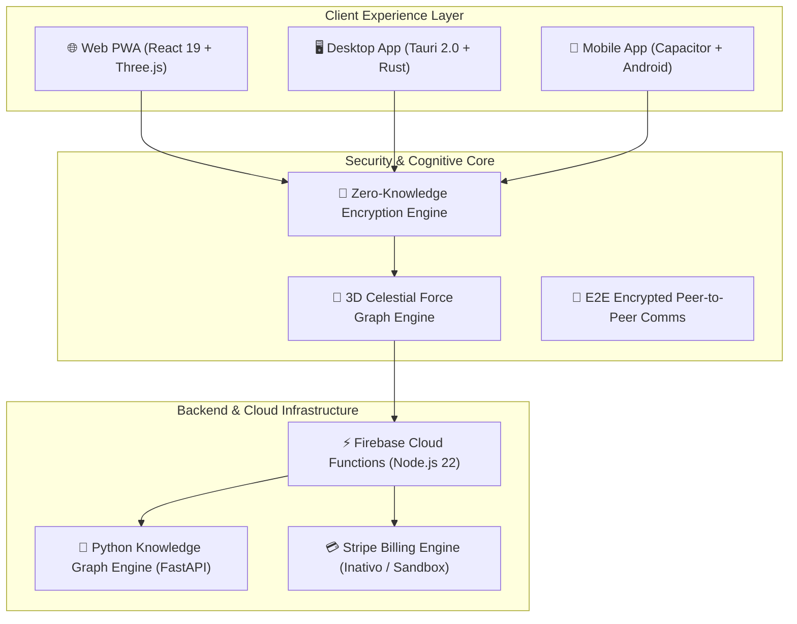

# Mnemosyne 🧠✨
### *The 3D Cognitive Universe & Self-Evolving Spatial Memory OS*

---

## 🌐 Official Website & Production Portal

- **Official Web Domain**: [https://mnemosyne-one.com](https://mnemosyne-one.com)
- **Live Production App**: [https://mnemosyne-one.web.app](https://mnemosyne-one.web.app)

---

## 💳 Sistema de Pagamentos / Payment System Architecture

> [!IMPORTANT]
> **Status do Sistema de Pagamentos**:
> O **Mnemosyne** possui uma infraestrutura de faturação e assinaturas totalmente desenvolvida em código (integração com **Stripe Checkout**, **Stripe Billing Portal**, webhooks com **Firebase Cloud Functions** e modelos de limites Pro/Enterprise).
> 
> **Nota de Ativação**: O sistema de pagamentos **ainda não está ativo no ambiente de produção público**. A aplicação opera no modelo **Founder Preview / Free-First** para permitir a construção de mercado e testes abertos pela comunidade antes da ativação das cobranças comerciais.

---

## 📱 Aplicativo Mobile & Google Play Store

> [!NOTE]
> **Status da App Mobile (Android)**:
> O aplicativo móvel Android está completamente desenvolvido e configurado via **Capacitor 8**, porém **ainda não está disponibilizado publicamente na Google Play Store** (em fase de testes internos e compilação de pacotes APK/AAB).

---

## 🌟 Executive Overview / Visão Geral

**Mnemosyne** é um Sistema Operacional de Memória Cognitiva Espacial em 3D. Combinando visualizações gráficas em tempo real (Three.js/WebGL), encriptação Zero-Knowledge (ZK), síntese por inteligência artificial e comunicação E2E entre nós, o Mnemosyne transforma dados fragmentados em universos cognitivos interativos.

> **English**: Mnemosyne is a 3D Spatial Cognitive Memory Operating System. Blending real-time Three.js/WebGL graph visualizations, Zero-Knowledge (ZK) encryption, AI-driven synthesis, and peer-to-peer E2E encrypted communications, Mnemosyne turns fragmented knowledge into immersive 3D cognitive universes.

---

## 🚀 Architectural Pillars / Pilares da Arquitetura

---

## 🔥 Key Features

- **🌌 3D Celestial Graph Engine**: Interactive 3D universe mapping memories as nodes, links, and semantic clusters.
- **🔐 End-to-End & ZK Security**: Client-side AES-256-GCM encryption with BIP-39 mnemonic key derivation.
- **🤖 Autonomous AI Summarization**: Local & cloud AI integrations for semantic tagging and cognitive pulse analysis.
- **💬 Encrypted Communication Channels**: Multi-user direct and group messaging encrypted on device.
- **💳 Multi-Tier SaaS Ready**: Integrated Stripe subscription architecture (Free, Pro, Enterprise) ready for commercial launch.

---

## 💻 Tech Stack Overview

- **Frontend**: React 19, TypeScript, Vite, Tailwind CSS v4, Three.js, React Three Fiber, Framer Motion, Zustand.
- **Desktop & Mobile**: Tauri 2.0 (Rust), Capacitor 8 (Android).
- **Backend & Cloud**: Firebase Auth, Firestore, Cloud Storage, Cloud Functions (Node.js 22), Python 3.11 (FastAPI, NetworkX).
- **Billing**: Stripe API & Webhook Infrastructure (*currently in sandbox/disabled mode*).

---

## 📄 License & Contact

For business inquiries, strategic partnerships, or investment:
- **Domain**: [https://mnemosyne-one.com](https://mnemosyne-one.com)
- **App**: [https://mnemosyne-one.web.app](https://mnemosyne-one.web.app)
