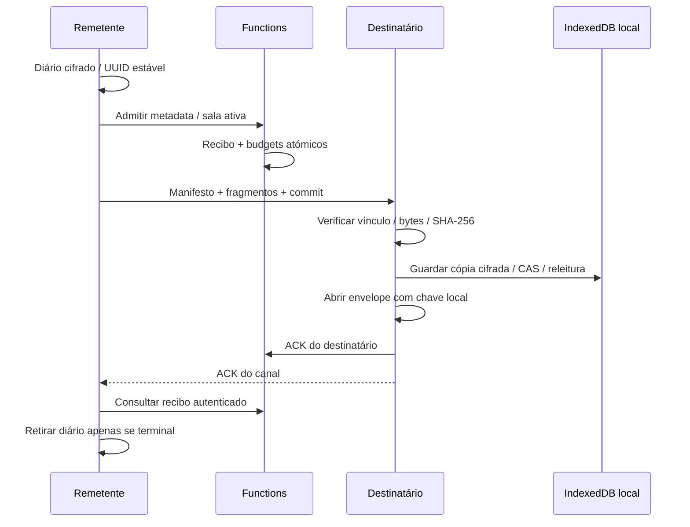

# Comms — entrega P2P recuperável

Data: 12 de outubro de 2026. Implementação local; gates de produção fechados.

## Contrato e confirmação

A mensagem e o anexo usam o envelope RSA/AES do Comms. O remetente guarda um diário cifrado por UID com UUID e envelope antes de qualquer admissão. Retomar conserva os mesmos bytes e ID; não volta a cifrar a composição. O diário impede um segundo envio até confirmar ou cancelar o primeiro. Consulta e cancelamento continuam disponíveis com o gate de admissão fechado.

Quatro callables em europe-west1 admitem, consultam, cancelam e confirmam o conteúdo. O servidor recebe apenas UUID, participantes, fingerprints, SHA-256, tamanho e vínculo da sala. Não recebe envelope, mensagem, nome do ficheiro ou anexo. O UID capturado tem de coincidir com Auth. Nova admissão exige ambas as contas ativas, chaves atuais e sessão P2P ativa com a mesma oferta/participantes. A admissão grava recibo privado e três budgets atomicamente. SDK não pode ler nem escrever estes recibos.

O servidor aceita uma declaração de tamanho e digest: não observa o transporte ou a cifra. O destinatário verifica tamanho/digest dos bytes reconstruídos, vínculo ao peer e fingerprints antes de guardar ou abrir. Um ACK é uma declaração autenticada do destinatário; não prova leitura humana, entrega a um dispositivo específico ou retenção futura.

O destinatário cifra o pacote integral com o cofre pessoal e confirma gravação em IndexedDB antes de decifrar a mensagem e pedir o ACK. Falha de disco, adulteração ou contexto retirado não pode produzir ACK. Perda da resposta de ACK conserva a cópia e permite confirmação manual. O ACK no canal apenas acorda o remetente: este exige recibo recebido do servidor antes de retirar o diário. Uma cópia local continua acessível depois de recarregar a página.

## Retoma, cancelamento e quotas

Uma transferência interrompida conserva o diário. Depois de fechar as referências da sala anterior e negociar com o mesmo destinatário/chaves, Retomar P2P pelo canal atual associa o mesmo recibo à nova sala sem consumir outra quota ou recifrar. Os dois participantes têm referências locais separadas; atualmente fecham explicitamente uma referência guardada antes de aceitar/abrir outra sala. Recuperação automática de referências fechadas/expiradas continua pendente.

As quotas diárias UTC são partilhadas com o relay: 100 pedidos/20 MiB por remetente, 100 pedidos/20 MiB por destinatário e 1.000 pedidos/200 MiB no projeto. Isto impede duplicar o orçamento mudando de transporte. Confirmar um recibo já admitido pode ocorrer depois do fecho da sala. Nova admissão/retoma exige uma sala ativa. Chave substituída não autoriza recifrar ou mudar o destinatário do diário.

Cancelamento desconhecido cria checkpoint terminal e consome um pedido do remetente/projeto, zero bytes e nenhuma quota do destinatário. Cancelamento de admissão não devolve quota; recebido é terminal e não pode ser retirado. Não é possível revogar cópias já recebidas. Após purga permanente do outro participante, consulta/cancelamento desconhecidos terminam sem recriar referências.

## Limites e armazenamento

| Limite | Valor |
| --- | --- |
| Pacote JSON cifrado | 600 KiB |
| Texto/anexo de composição | 32 KiB / 256 KiB |
| Frame JSON | até 16 KiB e até o máximo SCTP negociado |
| Dados por fragmento | 128 bytes a 8 KiB |
| Fragmentos por transferência | até 2.048 |
| Assemblers simultâneos | 2 / reserva total até 1.200 KiB |
| Expiração de reassembly | 60 s, verificada ao processar frames |
| Fila de entrada | 2 MiB / 2.200 frames |
| Backpressure | espera quando bufferedAmount supera 64 KiB; prazo 10 s |
| Espera de ACK no cliente | 15 s, seguida de consulta de recibo |
| Página local da inbox | 10 linhas + um candidato para cursor |

Frames têm roomId, transferId e requestId; o manifesto inclui descriptor/tamanho/contagem. JSON, schema, UTF-8 e base64 canónico são validados. Fragmentos misturados/conflituantes/incompletos são recusados. Máximo SCTP ausente, inválido ou insuficiente impede envio, sem supor um valor.

A inbox IndexedDB usa chave composta UID/UUID e índice UID/timestamp/UUID. Corpo, envelope original e nome do ficheiro ficam dentro da cifra pessoal; UID/digest/tamanho/tempos permanecem metadata local. CAS impede substituição concorrente. Cursores de outra conta são recusados. Limpeza de conta elimina apenas o intervalo do UID e os seus diários; o servidor remove recibos nas duas direções, mantendo o budget global. Um registo local inválido atualmente falha a página com erro explícito; tratamento por linha fica pendente.

IndexedDB/localStorage não são backup nem sincronização entre instalações. Limpar dados do navegador pode perder a cópia ou diário. Estas alterações não criam backup das identidades, preservação indefinida, exportação ou restauração entre dispositivos. O conteúdo não é guardado pelo servidor de recibos.

## Validação e rollout

Prova privada: W:\real\mnemosyne-launch-evidence\comms-p2p-content-local-validation-20261012.json. Os logs de falhas/reparações e hashes de fontes/artefactos são conservados separadamente das provas anteriores.

O ensaio Chromium usa painel, controladores, IndexedDB, Web Locks, RSA/AES, dois peers WebRTC nativos e executores backend reais. Auth/RPC/DB são fronteiras sintéticas em localhost. Verifica cópia antes de ACK, perda da resposta, reload, anexo de 192 KiB interrompido/retomado noutra sala sem quota adicional e paginação/CAS/purga UID no IndexedDB nativo. Não valida Firebase Auth cloud, STUN/TURN externo, Android/Tauri ou produção.

38 gates / 19 fontes permanecem fechados. Nenhum deploy, alerta, fornecedor real ou mutação de produção foi executado neste incremento. Limpeza automática de SDP/ICE expirados, legado/reconciliação, pilotos/cutover, identidades/equipas/writers e restantes fases 0–6 continuam por concluir antes do deploy completo autorizado. O plano operacional usa wgftechnologies@gmail.com e ainda não foi ativado nem teve entrega verificada.

Rollback mantém admissão fechada e consulta/cancelamento/ACK de operações existentes; não elimina recibos/diários nem reabre escritas SDK. Cópias recebidas não são retiradas por rollback.
