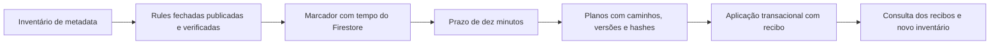

# Comms — inventário e reconciliação do P2P antigo

Data: 12 de outubro de 2026. Implementação validada localmente; reconciliação de produção pendente.

## Estado observado

A consulta Admin de metadata a mnemosyne-one / (default), às 11:45:43 UTC de 12 de outubro, percorreu as três fontes conhecidas:

| Fonte | Resultado |
| --- | --- |
| p2pRooms | 5 salas com schema antigo |
| callerCandidates | 10 candidatos associados a salas antigas |
| calleeCandidates | 4 candidatos associados a salas antigas |
| Candidatos órfãos observados | 0 |

Projeções não devolveram SDP, ICE, callerLabel ou conteúdo de cápsulas. O resultado agregado está em W:\real\mnemosyne-launch-evidence\comms-p2p-legacy-validation-20261012\production-metadata-final.json, com bindingVerified=true, complete=true, clean=false e productionMutations=0. São páginas independentes e releituras pontuais dos pais; não constituem uma fotografia global transacional. A saúde integral das rooms v2 é verificada pelos contratos próprios, não inferida deste inventário.

Nenhuma destas cinco salas foi alterada. SDK fechado publicado, marcador, espera, planos e aplicação ficam para o rollout completo autorizado, depois das restantes áreas.

## Autoridade de limpeza

O código antigo gravava createdAt e updatedAt com Date.now() do cliente. Essas datas não autorizam purga. A reconciliação usa o updateTime do Firestore de cada documento, o readTime do servidor e um marcador de cutover ativado com serverTimestamp.

Antes de criar/ativar o marcador, o CLI confirma projeto ativo, base (default), release de rules, ruleset e SHA256 dos bytes publicados igual ao source local fechado. A release é relida para detetar mudança durante a observação. O serviço repete essa verificação antes e depois do primeiro estado pending; uma alteração deixa o marcador inativo. Repetir o mesmo ID com a mesma política não reinicia o prazo. Cada preparação/aplicação volta a verificar a política e o vínculo do marcador.

A verificação de source integra os testes de negação SDK; não é uma prova formal independente da linguagem Rules. O hash tem de corresponder à revisão validada. A [Rules API oficial](https://firebase.google.com/docs/reference/rules/rest) permite ler a release e o source do ruleset; não há publicação de rules neste CLI. Mudanças concorrentes de administração entre Rules API e Firestore não são uma transação conjunta: o rollout deve conservar a política fechada durante a reconciliação e verificar novamente o resultado.

Após a ativação, a implementação de produção exige dez minutos medidos com tempos do Firestore. Um documento posterior ao marcador, uma versão substituída, uma room v2 ou um namespace desconhecido não podem ser adotados como legado. Não se usa mtime local, relógio da aplicação ou status closed isolado como autoridade.



## Plano e transação

O plano tem projectId, UUID estável, cutoverId, modo room/orphan e observações de caminhos, versões seconds/nanoseconds e hashes de metadata. Não inclui campos de UID dos participantes, SDP, ICE, labels ou mensagem. Caminhos e hashes podem ser correlacionáveis; os manifestos e recibos são dados sensíveis de operação, não dados anónimos.

Cada plano de room seleciona até 32 candidatos por lado, em ordem de ID. A transação relê as mesmas versões e a mesma seleção; uma mudança até em SDP/ICE não projetados altera updateTime e aborta antes de escrever. O recibo e as remoções são atómicos. Só são retirados offer, answer e callerLabel; o status passa a closed e fica um comprovativo de limpeza. Campos adicionais, metadata antiga, conteúdo cifrado e budgets são conservados. A room não é promovida a v2 nem é apagada por inteiro.

Coleções maiores usam novos planos explícitos para os lotes seguintes. Uma continuação só aceita a geração gravada pelo recibo privado anterior, do mesmo cutover, com o mesmo commit version da room. Uma reescrita manual posterior não pode ser aceite por ajustar a data do cliente. Um ACK perdido consulta/reaplica o mesmo plano/UUID; não regenera IDs nem rebaseia silenciosamente.

Um plano de orphan só elimina o candidato cujo pai continua ausente na transação e cuja versão precede o marcador. Recriar o pai ou substituir o candidato impede a remoção. Collection groups com o mesmo nome noutros namespaces são classificados como unsupported e conservados.

Recibos privados usam callerUid/calleeUid/ownerUid para limpeza de conta nas direções correspondentes. Marcadores permanentes de eliminação suprimem novos vínculos a participantes purgados; o worker da conta remove os recibos existentes e conserva os de outras contas. Os controlos globais de cutover continuam privados. Rules negam leitura/listagem/escrita SDK de ambos os roots.

Esta operação retira sinalização do servidor. Ligações RTC já estabelecidas e cópias recebidas não são revogadas. Retenção/backup dos dados restantes e migração entre instalações conservam os seus critérios separados.

## CLI de operação

scripts/reconcile-comms-p2p-legacy.js usa Node 22, projeto explícito, base (default) e ficheiro absoluto novo de output. Não sobrescreve evidência. O modo por defeito é inventory; apply e cutover param antes de credenciais/RPC se COMMS_P2P_LEGACY_RECONCILIATION_ENABLED estiver false. prepare é leitura, mas exige um marcador/política atuais e o prazo concluído. status consulta recibos históricos mesmo com o gate fechado.

| Modo | Ação |
| --- | --- |
| inventory | Três scans projetados, páginas até 50, relatório agregado |
| cutover | Verificar política e gravar/ativar o marcador com ID fornecido |
| prepare | Gravar manifesto local de planos; nenhuma escrita cloud |
| apply | Aplicar apenas os planos do manifesto, com as versões capturadas |
| status | Consultar os mesmos recibos sem repetir alterações |
| inventory --require-clean | Falhar se permanecer legado/candidato antigo/órfão/unsupported nas fontes conhecidas |

Cada fonte tem cap de 1.000 páginas e a preparação cap de 1.000 planos. Não há query sem limite, delete recursivo ou descoberta de propriedade por URL. cleanScope é known-legacy-signaling-metadata: clean não significa que todas as fases, devices, identidades ou dados v2 estão verificados.

Sequência do rollout: publicar/verificar a revisão fechada das rules; guardar um cutoverId estável; criar/retomar o mesmo marcador; esperar o prazo; preparar/rever o manifesto; aplicar; consultar recibos após qualquer resposta incerta; repetir novos planos apenas para lotes restantes; terminar com inventário require-clean e smokes. Falha no meio de vários planos pode deixar os anteriores aplicados. O manifesto/IDs permanecem o ponto de recuperação; o processo não declara sucesso total nem rollback automático nessa situação.

Exemplo de inventário, sem alterações:

```powershell
& 'W:\real\mnemosyne-launch-tools\node-v22.23.3-win-x64\node.exe' `
  scripts/reconcile-comms-p2p-legacy.js --project=mnemosyne-one `
  --out=W:/real/mnemosyne-launch-evidence/novo-inventario-p2p.json
```

Os modos de escrita exigem --mode, --cutover-id ou --manifest conforme o modo, e --expected-rules-sha256 para a política validada. O CLI rejeita contexto de emulador para operações cloud; testes usam o serviço diretamente com contexto demo explícito.

## Evidência

311 testes gerais Functions + um skip separado, antes do último reforço da base (default); 17 focados finais incluem dez contratos/serviço, três Rules API/CLI e quatro pipeline. Cinco testes finais no emulador validam versões reais, commit de continuação, negação SDK, órfãos/paginação e limpeza de conta. O emulador usa política Rules API sintética e graceMs=0; o prazo default de dez minutos é verificado no teste de unidade, não por espera real cloud. O CLI não expõe esse ajuste de fixture. CI passa a incluir os testes Rules API/CLI; a execução remota de CI não foi feita neste incremento.

Frontend, dependências, índices e storage.rules não foram alterados; os hashes/artifactos da prova anterior conservam a verificação própria. Não se repetiram testes/build frontend ou audits para alegar resultados novos. Falhas iniciais do getter SDK tipado e do mock de query foram reparadas e os logs preservados.

Prova privada: W:\real\mnemosyne-launch-evidence\comms-p2p-legacy-local-validation-20261012.json. 40 gates / 21 fontes permanecem fechados. Sem cutover/aplicação/deploy/fornecedor generativo/alertas ativados. O objetivo continua todas as fases 0–6 antes do deploy completo autorizado. wgftechnologies@gmail.com continua no plano operacional, ainda não ativado nem entregue.
