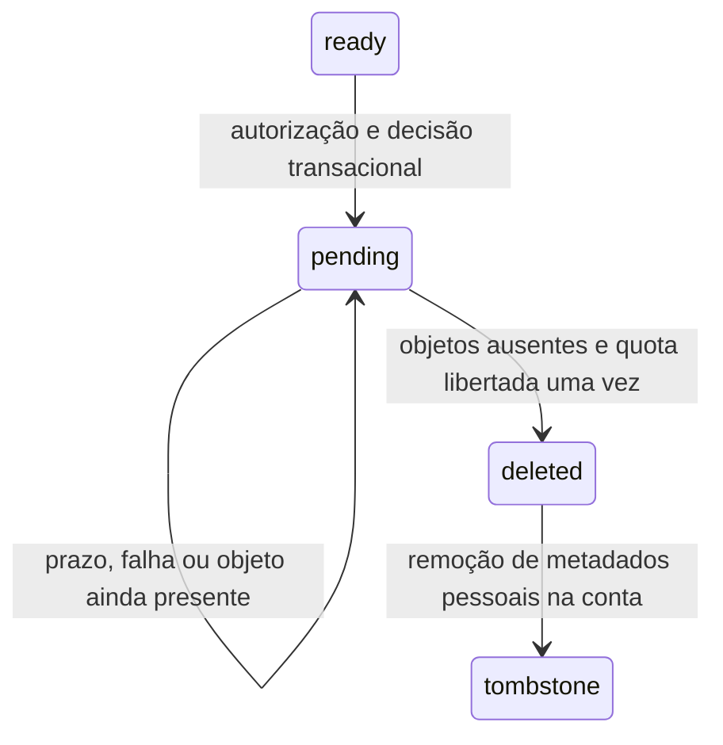

# Eliminação de anexos e contas — 2 de outubro de 2026

## Estado e âmbito

Implementação local do ciclo de eliminação de ficheiros cifrados e do pedido de eliminação de conta. **As fases 0–6 e o lançamento completo continuam por concluir.** Não houve deploy, eliminação de objetos reais, alteração de quotas reais ou cancelamento de uma subscrição real neste bloco.

Uploads, associações, criação com anexos, escrita de equipas, purge de órfãos e início de eliminação automática de conta continuam fechados. A autorização humana para deploy completo mantém a condição de terminar todas as áreas e verificações. Os gates são temporários; o objetivo continua a ser o produto completo definido no prompt mestre.

O novo fluxo não ignora falhas de Storage nem devolve sucesso nos casos testados enquanto existirem objetos, quotas por libertar ou dados cuja remoção não foi confirmada. Isso **não prova o encerramento de todas as escritas concorrentes do produto**; estas são um requisito para abrir o gate.

Incremento seguinte: login desktop, quotas/chaves/utilização, IA/API/MCP/ledger, destinatários P2P/transmissões/partilhas e novas leituras/referências de anexos passam a observar o marcador. Membership/rotação precedem a enumeração de filhos das memórias. Evidência, limites e pendências atualizadas: [ADMISSAO_CONTAS_E_OPERACOES_EM_CURSO.md](ADMISSAO_CONTAS_E_OPERACOES_EM_CURSO.md), com **122 unitários Functions e 76 +22 no emulador**. Estado do programa inteiro: [ESTADO_LANCAMENTO_COMPLETO.md](ESTADO_LANCAMENTO_COMPLETO.md).

## Registo e estados dos ficheiros

`attachmentUploads/{id}` conserva cabeçalho cifrado, digest, bucket, caminhos canónicos, tamanho e gerações. Novas reservas incluem `referenceSchemaVersion:1` e `referenceRevision:0`. Criação/associação tocam a revisão na mesma transação que escreve a referência, serializando uma decisão de purge contra uma nova referência.

`ready` passa a `purgeState:'pending'`, com UUID, motivo, `purgeAfter` e quota ainda cobrada. Leituras/novas associações/publicações normais rejeitam esse registo. O status de recuperação trata-o como cancelado sem fornecer conteúdo ou URL. Após remoção confirmada passa a `deleted`, com `storedQuotaReleased:true`, `purgedAt` e limpeza pendente encerrada.

### Ficheiro sem referências

Somente o uploader pode pedir purge; num ficheiro de equipa exige também pertença atual. Registos antigos sem a versão de referências validada precisam de migração verificada antes de inferir ausência.

A transação procura o descriptor opaco canónico nas sessões atuais e no grupo `versions`. **Referências históricas e sessões com tombstone conservam o ficheiro.** Remover da lista atual não permite apagar bytes que uma versão anterior ainda referencia.

O pedido bloqueia novas utilizações antes da remoção. Espera pelo maior prazo entre URLs de leitura de dois minutos, POST e lease de publicação, com margem de um minuto. Um acesso temporário já emitido pode continuar durante o seu prazo; não existe revogação retroativa de bytes descarregados.

A remoção fixa a geração publicada, remove a quarentena e confirma separadamente que ambos os caminhos não têm objeto vivo. Só 404 confirma ausência. Falha do fornecedor, geração diferente e objeto ainda presente conservam a cobrança. A transação desconta uma vez as quotas de utilizador/equipa e a cópia de limpeza ainda cobrada; workers concorrentes não descontam duas vezes.

### Conta e equipas do dono

O purge de conta pagina registos por UID. Reservas/POSTs/leases pendentes são cancelados e esperam pelos prazos. Ficheiros `ready` entram em purge mesmo referenciados, porque os dados associados à conta estão a ser eliminados. Auth permanece disponível para retomar durante estas etapas.

Ao eliminar a conta do dono, a equipa é congelada e o seu ID fica num checkpoint do pedido. O purge inclui uploads de outros membros dessa equipa e desconta as quotas correspondentes. Depois remove sessões/histórico, épocas e metadados da equipa. A UI apresenta esse efeito antes da confirmação.

Depois da limpeza, `attachmentObjectTombstones/{id}` conserva só `{v,digest,status,deletedAt}`, sem UID, cabeçalho, bucket ou caminhos. É permanente para impedir reutilização do UUID, sem representar prova de anonimização jurídica. Cancelamentos anteriores à reserva também são convertidos. Só se remove uma quota de utilizador/equipa quando todos os contadores forem zero.

## Pedido de eliminação de conta

Payload estrito `{uid}` ou `{uid,recoveryToken}`, correspondente à conta autenticada originalmente confirmada. O campo opcional permite a recuperação descrita abaixo e conserva a compatibilidade de clientes anteriores. A UI captura o UID **antes** das duas confirmações. Mudar de conta, incluindo sair e regressar enquanto a resposta está em curso, invalida a confirmação/ACK.

`accountDeletions/{uid}` é um marcador permanente server-only. Fecha pedidos Firestore desse UID entre a remoção do perfil e a expiração de JWTs antigos. Sessões pessoais partilhadas recusam leitura/escrita quando o autor tem esse marcador.

| Etapa | Comportamento e confirmação |
|---|---|
| `freeze-teams` | Marca o perfil como `deleting`; lease de dez minutos para uma Function limitada a nove; conserva IDs/cursor e fecha membros/wraps das equipas do dono |
| `objects` | Confirma billing, remove anexos cifrados de equipa/conta e verifica prefixo Storage legado; espera pelos prazos necessários |
| `documents` | Remove membership/dispara rotação antes de enumerar sessões/filhos; retira wraps históricos válidos, recibos, grants/códigos/sessões OAuth, budgets, bridges, sincronização, P2P e subcoleções do perfil |
| `auth` | Só entra depois das etapas anteriores; remove Auth e perfil. `auth/user-not-found` numa repetição confirma o mesmo apagamento |
| `complete` | Conserva o marcador mínimo de revogação; responde `{uid,status:'complete',retryAt:null}` |

As páginas limitadas verificam se ficaram documentos. Atingir um cap gera pendência/erro para repetir, nunca sucesso. Lease impede dois workers da mesma conta em simultâneo. Cada fase confirmada é persistida; erro liberta o lease mas conserva o pedido.

**Falha recursiva:** a SDK instalada apaga o pai mesmo quando filhos falham. O helper novo apaga coleções filhas primeiro e só remove o pai quando todas confirmam sucesso. Assim uma repetição ainda encontra o documento pela consulta. Falta encerrar todas as escritas concorrentes de terceiros antes de abrir o gate.

Storage legado é paginado sem `force:true`, com geração fixa e ausência confirmada. Ficheiro legado de equipa sem propriedade confiável interrompe o pedido para revisão/migração: não se adivinha se pode apagar bytes de outro uploader.

Stripe deixa de ser best-effort: configuração ausente ou falha de leitura/cancelamento/customer conserva identificadores e interrompe a fase. Repetição reconhece subscrição já cancelada/recurso ausente. Um helper transacional impede webhooks/sync de recriar perfil, entitlement ou notificação após o marcador. Sem chamadas Stripe reais neste bloco.

Wraps do UID são removidos das épocas históricas válidas, sem relabeling ou alteração de wrappers de outros membros. Convites remanescentes após o cap fazem a eliminação falhar para retomar. Dados malformados/órfãos precisam de inventário e migração.

## Recuperação no cliente

Checkpoint pequeno de UID/estado/comprovativo de consulta é gravado e relido antes do pedido; não contém memórias, nomes, ficheiros ou chaves do cofre. Checkpoints anteriores continuam legíveis. Cofre bloqueado antes da operação. ACK ausente/malformado/estranho ou perda de contexto conserva checkpoint e rascunhos.

`pending` não limpa dados locais nem termina Auth. `/account-deletion` consulta/retoma sem ler o perfil Firestore bloqueado. Repetição consulta status primeiro; `unknown` sem checkpoint/consentimento anterior não inicia eliminação. A UI distingue pedido local não confirmado de pedido remoto em curso.

Após confirmação remota grava `remote-complete` antes de limpar. Remove só chaves atribuíveis ao UID, IndexedDB de uploads/reindex e credenciais mobile correspondentes. Não usa `localStorage.clear()`/`sessionStorage.clear()` para apagar outras contas. PIN/WebAuthn legados sem UID só são removidos enquanto a conta confirmada permanece ativa; não se adivinha propriedade desses gates quando Auth desapareceu.

Falha local conserva `remote-complete`. Depois de Auth desaparecer pode limpar offline uma conclusão já confirmada, sem repetir apagamento remoto nem limpar outra conta ativa. ACK tardio depois de mudar conta/desmontar painel não termina a nova sessão nem anuncia sucesso.

**Atualização de 3 de outubro:** o cliente guarda agora um comprovativo antes do pedido e o servidor regista apenas o seu digest, ligado ao UID, numa transação. A consulta por comprovativo pode confirmar a conclusão sem Auth; não inicia nem retoma apagamento. Um worker privado termina somente a fase `auth` já persistida, após lease, incluindo a perda do ACK de Auth. A limpeza local continua a exigir conclusão válida; checkpoints antigos pendentes sem comprovativo e sem Auth permanecem para suporte. O piloto real continua pendente. Contrato, limites e evidência: [RECUPERACAO_CONTA_SEM_AUTENTICACAO.md](RECUPERACAO_CONTA_SEM_AUTENTICACAO.md).

## Índices, rollout e rollback

Índices single-field `CONTAINS/COLLECTION_GROUP` para `versions.attachments` e `keyEpochs.memberUids`, mantendo `COLLECTION`. SDK/emulador não comprovam índices ativos no projeto real; configuração segue a [referência oficial Firestore](https://firebase.google.com/docs/reference/firestore/indexes).

Novas coleções negam acesso direto do cliente. Reservas recusam IDs com tombstone de cancelamento/objeto; nenhum TTL reabre IDs/contas. Publicação exige coordenação Functions/regras/índices/cliente: o callable novo exige `{uid}` e não devolve o `success:true` legado.

Rollback fecha pedidos novos/purges/uploads/equipas, conserva marcadores/quotas/journals e mantém recuperação de pedidos já marcados. Fechar o gate não pode impedir repetição de uma conta já autorizada e persistida. Não reabrir Storage em claro nem apagar tombstones.

## Retenção e limites

Ausência de objeto vivo não confirma expiração de soft delete, versões administrativas, backups ou cópias descarregadas. Soft delete conserva objetos segundo a política do bucket; ver [Google Cloud](https://docs.cloud.google.com/storage/docs/soft-delete). A política real Mnemosyne não foi verificada aqui; não se afirma apagamento físico imediato ou custo zero. A quota representa bytes ativos do protocolo.

Sem ensaio em bucket real, migração/tokens legados, medição de custo ou restauração. Cifra continua a processar o ficheiro inteiro. Não há novo scan cloud do original.

## Evidência de validação

- Node portátil **22.23.3**, Firestore/Storage Emulator e **JDK 21.0.6** do Android Studio; projeto `demo-mnemosyne-rules`, credenciais de aplicação retiradas do processo.
- Primeira suite: **53 Functions passaram**, frontend **21 passaram/1 falhou**. O marcador fez uma ligação recíproca válida exceder 1000 expressões. Simplificaram-se verificações equivalentes de campos ausentes/nulos; o bloqueio ficou mantido. Frontend voltou a passar **22/22**.
- Com conta/billing: **57 +22** no emulador. Com filhos/wraps históricos/bloqueio do autor pessoal: **59 Functions +22 frontend**, saída zero. Depois da correção de recuperação com gate fechado: **sete testes selecionados por `account`**, saída zero, incluindo início recusado sem marker e repetição de marker concluído.
- Functions: **116 passaram**, uma suite de regras ignorada fora do emulador. Import real do entrypoint fresco/Admin previamente inicializado, adapter GCS, falha de filhos, paginação Storage e binding UID incluídos.
- Frontend: primeira geral **465/100 ficheiros**; final estável **467/100 ficheiros**, saída zero, com nove testes de serviço e quatro do painel. Não se aumentaram timeouts nem ignoraram testes.
- Chromium real: reload, abort transacional, bytes libertados em `ready`, paginação/isolation e limpeza do range de Alice preservando Bob passaram.
- Builds Functions/TypeScript e frontend/Vite finais passaram; Vite transformou **3239 módulos**, com os avisos já conhecidos de chunks grandes/imports mistos. Lint final: **zero erros e 23 avisos preexistentes**, sem aviso novo do painel.
- Lint detetou um aviso novo da ref no cleanup do painel. Lifecycle corrigido sem ignorar a regra. Alguns pedidos negativos de regras ainda produzem mensagens do limite de expressões; todas as transações válidas desta matriz passaram, sem afirmar profiling geral das regras.
- `git diff --check` do escopo rastreado passou; ficheiros novos de lifecycle foram verificados sem whitespace no fim das linhas. Isto não declara o repositório inteiro limpo. Processos de testes, emuladores e browser terminaram normalmente.

## Trabalho antes de abrir gates e lançar

O incremento de eliminação normal de equipa, a descoberta entre dispositivos e a prova `objectsComplete` na passagem para a eliminação da conta estão em [ELIMINACAO_RECUPERAVEL_EQUIPAS.md](ELIMINACAO_RECUPERAVEL_EQUIPAS.md). Essa revisão passou 88 +22 testes na suite completa de emulador e 492 testes gerais frontend. Os resultados anteriores abaixo mantêm-se como cronologia, não como declaração de conclusão das fases 0–6.

1. Completar o inventário de escritores/retention de equipas, convites, notificações, commits de rotação e metadados que referenciam o UID; resolver ownership/referências de ficheiros em equipas de outro dono. Bridges, providers, P2P/transmissões/partilhas e ordem membership/filhos têm evidência no incremento acima, sem provar o programa completo.
2. Inventário/migração de filhos já sem pai, ownership/caminhos legados e `deleting` do esquema antigo. Confirmar que descriptors canónicos abrangem todos os escritores de referências.
3. UI/inventário de purge explícito, memória/histórico definitivamente eliminado e recuperação de lote/épocas antigas. Callable normal de purge existe, fechado; inventário remoto não está ativado na UI.
4. Piloto real da recuperação ACK/Auth implementada, incluindo reload/perda de rede e a matriz web/Tauri/Android, sem prometer apagar cópias externas.
5. Piloto GCS/Stripe/Auth isolado, IAM/CORS, índices ativos, assinaturas/precondições/limites, App Check, retenção real de soft delete/backup e restauração isolada.
6. Demais fases 0–6: todos os chamadores de privacidade, migração/rekey/piloto de equipas, avaliação/retrieval da pesquisa, ações aprovadas/reversão, acessibilidade/devices, CI/segredos/rollback/smoke.

Este bloco não permite marcar a fase 4, a auditoria inteira ou o lançamento como concluídos.
