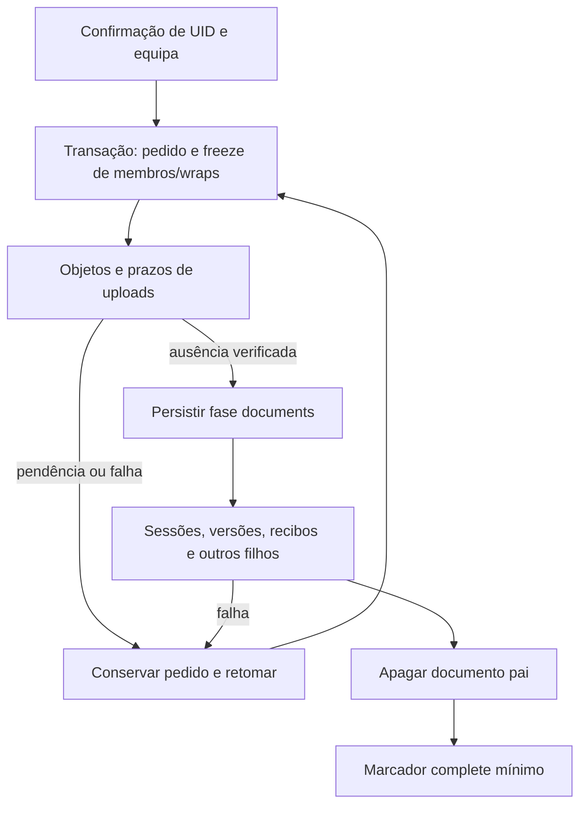

# Eliminação recuperável de equipas — 2 de outubro de 2026

## Estado e âmbito

O percurso local de eliminação de uma equipa pelo proprietário usa um pedido durável, limpeza verificada de objetos e preservação dos documentos que permitem retomar. Substitui o callable legado que apagava apenas convites e o documento pai. `TEAM_DELETION_ENABLED` permanece fechado no servidor e no cliente até cumprir migração, piloto e retenção. Pedidos já persistidos continuam a poder ser consultados e retomados com o gate fechado.

A autorização humana permite o deploy completo depois de concluir todas as áreas das fases 0–6. Este incremento não declara esses critérios cumpridos. Não foram feitas operações de produção, chamadas GCS/Stripe/Auth reais ou publicação de binários neste incremento.

## Contratos

| Operação | Pedido | Resultado |
|---|---|---|
| `deleteTeam` | `{teamId,expectedUid}`; Auth deve coincidir com `expectedUid` | `{uid,teamId,status:'pending'|'complete',retryAt}` |
| `getTeamDeletionStatus` | Mesmo binding | Mesmo resultado, com `unknown` quando não existe pedido autorizado |
| `getPendingTeamDeletions` | `{expectedUid,afterTeamId:null|string}` | `{uid,requests,nextAfterTeamId}`; até 25 pedidos do proprietário por página |

Campos adicionais, IDs inválidos e o payload antigo `{teamId}` são recusados. As três operações usam limite por UID. O cliente não lê nem escreve diretamente `teamDeletions`. A descoberta consulta pedidos pelo proprietário e funciona mesmo depois de membros e documento pai desaparecerem. Não inicia uma eliminação nem grava um checkpoint.

## Protocolo do servidor

- O perfil e marcador permanente de eliminação da conta são observados antes da admissão. Só o proprietário atual pode iniciar o pedido.
- A primeira transação fecha membership, wraps, papéis e rotação antes da limpeza. O lease de dez minutos excede o timeout de nove minutos da Function. Outro worker devolve pendência enquanto o lease estiver ativo.
- A autoridade interna `team-deletion` exige a conta ativa, equipa congelada, wraps vazios e pedido válido na fase `objects` com lease ativo. Permite purgar uploads de outros membros apenas nessa equipa. Não concede a um proprietário autoridade geral sobre uploads pessoais.
- O protocolo de anexos conserva a espera por leases/assinaturas, geração fixa, confirmação de ausência e libertação única de quota. Falha do adapter não transforma uma pendência em sucesso.
- A fase `documents` só é persistida depois de concluir os objetos. Filhos são eliminados antes do pai; falha numa subcoleção conserva a sessão/equipa como âncora para repetir.
- Recibos de anexos/criação/utilização ligados à sessão são removidos, mesmo sem `teamId` no recibo. Convites, auditoria, rotações, pedidos de rotação e notificações ligadas à equipa são limpos. URLs legados sem ownership verificável interrompem o percurso e conservam a âncora.
- Recibos da criação original da equipa são cancelados e perdem `teamId`; não são simplesmente apagados. Uma resposta de criação perdida não pode recriar a equipa/chave após a eliminação. IDs de equipa com marcador não podem ser reutilizados.
- Se apagar o pai tiver sucedido e o ACK se perder, a fase `documents` permite retomar sem o pai e concluir o marcador. A fase `objects` sem pai não fornece essa prova.
- O marcador concluído conserva versão, digest do binding UID/equipa, estado, data e lease zero. Remove o UID literal e o worker. O digest é um identificador sensível pseudónimo; não se declara anonimização ou cumprimento de toda a política de retenção.

A eliminação normal de equipa não remove a conta do proprietário nem os seus dados pessoais. O teste conserva perfis e usa dependências sintéticas; não comprova estado de identidades Auth reais.

## Articulação com a eliminação da conta

O worker da conta pode concluir uma equipa cuja eliminação normal ficou interrompida. A âncora privada `accountDeletions/{uid}/teams/{teamId}` grava `objectsComplete:true` antes de apagar o pai. Numa repetição com pai ausente, exige essa prova e ausência de registos de uploads da equipa. Um marcador antigo sem prova mantém a identidade Auth e pede revisão. Depois de apagar os filhos/pai, conclui também o marcador da eliminação normal.

O trigger de utilização recebe o `createTime` do evento e verifica o documento atual. Não cria recibo nem cobra utilização quando a sessão desapareceu, está logicamente apagada, pertence a equipa revogada/congelada, ou foi recriada com outro `createTime`. O recibo existente continua a impedir cobrança dupla.

## Recuperação no cliente

O checkpoint contém apenas `{v,uid,teamId,phase}` e é gravado e relido antes do pedido. Um pedido de outra equipa não o sobrescreve. A confirmação explica que a operação inclui memórias, histórico e anexos de todos os membros daquela equipa; dados pessoais são preservados e cópias offline/exportadas podem permanecer.

`pending` não limpa cache/journals nem anuncia conclusão. Resposta perdida, malformada, de outro UID/equipa ou recebida depois de perder contexto conserva a preparação. Retomar consulta o estado primeiro; `unknown` sem preparação anterior não inicia apagamento.

O cliente grava `remote-complete` antes da limpeza local. Falha local conserva esse estado e a repetição não volta a apagar no servidor. Limpa a cache da equipa e os journals de rotação/histórico dessa combinação UID/equipa. A limpeza da conta inclui só o seu checkpoint de equipa, mantendo os de outros UIDs.

O painel mantém recuperação quando a equipa desaparece da lista, permite procurar pedidos remotos noutro dispositivo e suporta paginação. A confirmação é invalidada por mudança de Auth, mesmo quando se regressa ao UID original; respostas após desmontar o painel não anunciam sucesso. A recuperação é permitida com o gate fechado.

## Evidência local

- Node portátil **22.23.3**, JBR **21.0.6**, Firestore/Storage Emulator no projeto **`demo-mnemosyne-rules`**, sem credenciais de aplicação no processo.
- Functions: **129 testes unitários passaram**, uma suite de regras ignorada fora do emulador; compilação TypeScript incluída.
- Suite completa final de emulador: **88 testes Functions + 22 testes frontend passaram**, saída zero. Inclui falha de Storage/filhos, ACK do pai perdido, leases concorrentes, recibo/ID de criação não reutilizável, descoberta por proprietário com 26 pedidos, takeover da conta e trigger antigo de utilização.
- Cliente: **40 testes focados em cinco ficheiros passaram**, incluindo serviço/painel de equipa, recuperação da conta e traduções. Lint dos nove ficheiros frontend alterados: **zero erros e zero avisos**.
- Build web final passou. Permanecem avisos conhecidos de chunks grandes; não se altera o limite para escondê-los.
- Logs locais: `%TEMP%/mnemosyne-team-deletion-unit.log`, `mnemosyne-team-deletion-rules-final.log`, `mnemosyne-team-deletion-frontend.log`, `mnemosyne-team-deletion-lint.log`, `mnemosyne-team-deletion-build-final.log`.
- Suite geral frontend posterior: **492 testes em 102 ficheiros passaram**, sem skips nem falhas apresentados no resumo Vitest; log `%TEMP%/mnemosyne-team-deletion-frontend-full.log`. O handle da shell já tinha terminado quando foi consultado; o resumo terminal do log foi confirmado, sem reiniciar o processo.

## Critérios ainda pendentes

1. Inventário/migração de URLs, tokens, filhos órfãos e referências a objetos de outras equipas ou de outros autores; nenhuma eliminação adivinha ownership legado.
2. Política para apagar a conta do uploader quando ficheiros continuam referenciados por outros autores numa equipa de outro proprietário; revisão completa de metadados com UID e retenção dos marcadores/recibos.
3. Piloto isolado real de GCS IAM/CORS/App Check, assinatura, geração, leases, quota e soft delete/versões/backups. Ausência do objeto vivo não comprova apagamento físico de todas as cópias.
4. Ensaio de restauração no destino isolado ainda por designar; a autorização de bucket/export não comprova restauração.
5. Matriz de clientes web/desktop/Android, comportamento offline e journals em todos os dispositivos. ACK perdido antes da confirmação remota e perda simultânea de Auth na eliminação da conta continua pendente no percurso próprio da conta.
6. Rollout coordenado de Functions, regras, índices e clientes. Abrir o gate só depois desses critérios; rollback conserva marcadores e recuperação. Todos os outros critérios das fases 0–6 mantêm-se no estado de lançamento completo.

## Correção da consulta de convites

A verificação adicional da consulta real do destinatário encontrou uma falha que a leitura individual não mostrava: consultar `teamInvites` por UID/status não permite às regras provar a equipa de cada resultado e a listagem é recusada. A execução ficou registada em `%TEMP%/mnemosyne-team-deletion-invite-query.log`. A condição de revogação não foi retirada para fazer essa consulta passar.

O novo índice de caixa de entrada `teamInviteInbox/{inviteId}` contém **só** `{v,uid,inviteId,teamId}`. É criado na mesma transação do convite e da auditoria. O destinatário lista os seus ponteiros, depois o cliente obtém cada convite individualmente com `getDocFromServer`; o wrap não existe na coleção listável. A leitura individual observa a conta do emissor/proprietário e o estado da equipa. Falhas, convites expirados/aceites, bindings incorretos e respostas depois de mudar conta/snapshot/desmontar não entram na lista apresentada.

Aceitação, expiração e recusa por mudança de época retiram o ponteiro na mesma transação. A eliminação de equipa/conta limpa os ponteiros correspondentes. A limpeza de convites enviados/recebidos usa páginas de 200 com duas escritas por linha, respeitando o limite de um batch.

**Migração obrigatória:** convites antigos sem ponteiro precisam de reconstrução verificada da caixa de entrada ou de novo convite emitido pelo proprietário. Não há backfill automático em produção neste incremento. Convites legados sem prova de época/identidade continuam a exigir migração antes de abrir os gates. A migração e os limites de volume desta listagem integram os critérios das fases 2–3.

Depois da correção, o cliente passou **43 testes focados em seis ficheiros**, **495 testes gerais em 103 ficheiros**, build web e lint dos dez ficheiros sem erros/avisos. Functions manteve **129 unitários**. A primeira execução de emulador da caixa de entrada encontrou um erro na ordem dos argumentos do Auth lookup da fixture nova; corrigiu-se a fixture de acordo com a assinatura real. A suite completa posterior passou **89 Functions +22 frontend**, sem skips, saída zero, com os emuladores encerrados normalmente. Logs: `%TEMP%/mnemosyne-team-invite-inbox-{unit,frontend,frontend-full,build,lint,rules,rules-final}.log`.

O incremento posterior de [REFERENCIAS_ANEXOS_E_ELIMINACAO_MEMBROS.md](REFERENCIAS_ANEXOS_E_ELIMINACAO_MEMBROS.md) implementou higiene recuperável dos descritores canónicos nas memórias/versões de outros autores, mantendo a sua cifra e os restantes ficheiros. O UID continua parte do AAD; referências não canónicas, ownership legado, órfãos e política de retenção dos metadados permanecem no inventário pendente. A manutenção da caixa de convites está descrita em [MIGRACAO_CAIXA_CONVITES.md](MIGRACAO_CAIXA_CONVITES.md).
