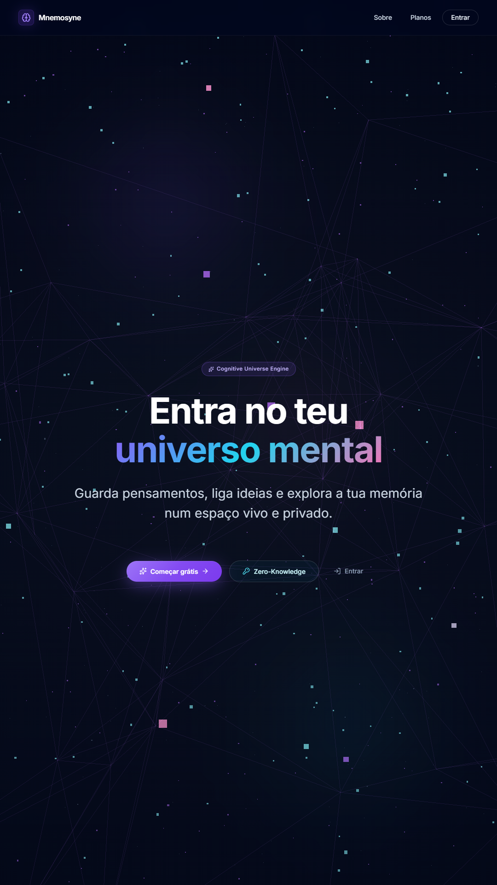
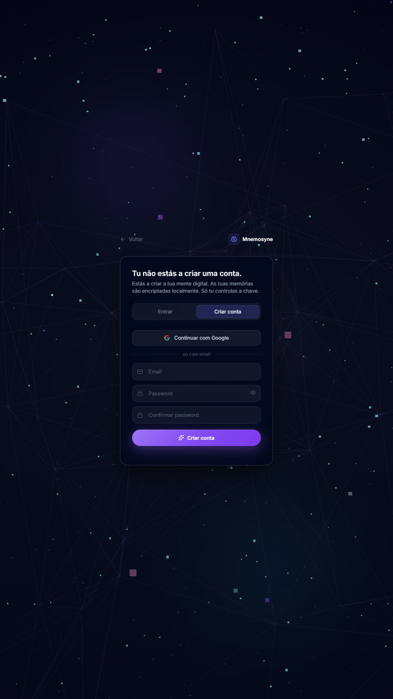
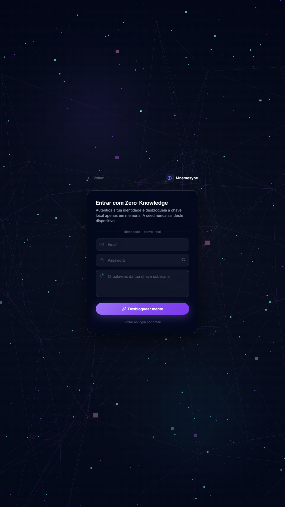
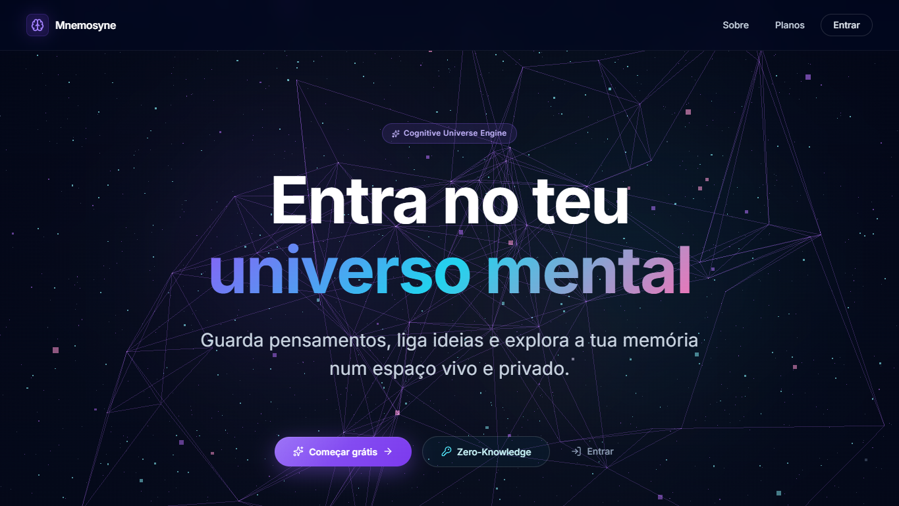

# Mnemosyne Play Store Listing Copy

Data: 2026-05-13
Package Android: `com.mnemosyne.mobile`
Estado comercial: Founder Preview gratuito

Este documento reune texto pronto para a ficha da Google Play e os assets gerados localmente para apoiar a publicacao.

## Requisitos de assets verificados

Referencia oficial consultada em 2026-05-13:

- Play Console Help, preview assets: https://support.google.com/googleplay/android-developer/answer/9866151

Resumo aplicavel ao Mnemosyne:

- Descricao breve: limite de 80 caracteres.
- Icone da app: PNG 32-bit com alpha, 512x512, ate 1024 KB.
- Feature graphic: JPEG ou PNG 24-bit sem alpha, 1024x500.
- Screenshots: minimo de 2; PNG/JPEG sem alpha; dimensao minima 320 px; dimensao maxima 3840 px; lado maior nao pode exceder 2x o lado menor.
- Para melhor elegibilidade promocional, usar pelo menos 4 screenshots de app com 1080x1920 em retrato ou 1920x1080 em paisagem.

## Descricao breve

Memorias privadas, IA local e universo cognitivo para ligar ideias.

## Descricao completa

Mnemosyne e um sistema operativo cognitivo pessoal para guardar pensamentos, organizar conhecimento e descobrir ligacoes entre ideias sem perder o controlo da tua memoria digital.

Com o Mnemosyne podes criar memorias, notas e reflexoes, pesquisar conteudo, editar registos, explorar relacoes num universo visual e usar assistencia de IA de forma consciente. A app foi desenhada para quem quer uma segunda mente privada, viva e facil de navegar.

O que podes fazer:

- Criar e editar memorias pessoais.
- Organizar ideias com etiquetas, ligacoes e contexto.
- Explorar o teu conhecimento num universo cognitivo visual.
- Pesquisar memorias e encontrar relacoes entre pensamentos.
- Usar insights locais para encontrar padroes, ideias isoladas e temas recorrentes.
- Configurar IA local ou provedores externos quando quiseres assistencia para texto, pesquisa e organizacao.
- Usar Comms e partilha cifrada quando ativados.
- Preparar sincronizacao entre web, desktop e mobile.

Privacidade e controlo estao no centro do Mnemosyne. A experiencia usa uma abordagem Zero-Knowledge: a chave soberana do utilizador e tratada localmente e o conteudo das memorias deve permanecer sob controlo do utilizador. Quando uma funcionalidade precisa de servicos externos, a app privilegia consentimento e configuracao explicita.

Nesta fase, o Mnemosyne esta em Founder Preview gratuito. A prioridade e entregar valor real, ganhar confianca e melhorar a experiencia com os primeiros utilizadores. Planos pagos poderao chegar no futuro para capacidades avancadas, equipas, infraestrutura gerida, compliance e suporte, sem transformar o nucleo da experiencia num muro artificial.

Ideal para:

- Notas pessoais e diario de ideias.
- Investigacao, estudo e aprendizagem.
- Organizacao de projetos e conhecimento.
- Criadores, estudantes, profissionais e pessoas que querem uma memoria digital soberana.

Mnemosyne transforma notas soltas num universo mental navegavel.

## Descricao completa alternativa curta

Mnemosyne e uma app de memoria privada para guardar pensamentos, ligar ideias e explorar conhecimento num universo cognitivo visual.

Cria memorias, pesquisa conteudo, organiza temas, descobre padroes e usa IA com controlo. A app foi desenhada com foco em privacidade, Zero-Knowledge e soberania do utilizador: as tuas memorias devem continuar tuas.

Durante o Founder Preview, o Mnemosyne esta gratuito para os primeiros utilizadores enquanto a experiencia e melhorada para lancamento publico.

## Sugestao de categoria

Categoria principal: Produtividade

Categorias possiveis:

- Produtividade
- Ferramentas
- Educacao

## URLs importantes

- Politica de privacidade: `https://mnemosyne-one.web.app/privacy.html`
- Eliminacao de conta: `https://mnemosyne-one.web.app/account-deletion.html`
- App web: `https://mnemosyne-one.web.app`

## Assets obrigatorios

| Ficheiro | Dimensao | Formato | Uso |
| --- | ---: | --- | --- |
| [`icon-512.png`](./playstore/icon-512.png) | 512x512 | PNG 32-bit com alpha | Icone da app na Play Console |
| [`feature-graphic-1024x500.png`](./playstore/feature-graphic-1024x500.png) | 1024x500 | PNG 24-bit sem alpha | Feature graphic da ficha |

## Capturas geradas

As capturas Play-ready foram criadas com Playwright a partir da app local em `http://127.0.0.1:5174`, usando viewport 1080x1920.

| Ficheiro | Dimensao | Uso sugerido |
| --- | ---: | --- |
| [`01-login-hero-phone.png`](./playstore/screenshots/01-login-hero-phone.png) | 1080x1920 | Primeira captura phone: entrada da app |
| [`02-create-account-phone.png`](./playstore/screenshots/02-create-account-phone.png) | 1080x1920 | Criacao de conta |
| [`03-zero-knowledge-phone.png`](./playstore/screenshots/03-zero-knowledge-phone.png) | 1080x1920 | Fluxo Zero-Knowledge |
| [`04-privacy-phone.png`](./playstore/screenshots/04-privacy-phone.png) | 1080x1920 | Politica de privacidade |
| [`05-account-deletion-phone.png`](./playstore/screenshots/05-account-deletion-phone.png) | 1080x1920 | Eliminacao de conta e dados |
| [`06-login-hero-desktop.png`](./playstore/screenshots/06-login-hero-desktop.png) | 1365x768 | Material de apoio para site, press kit ou docs |

As capturas antigas `*-mobile.png` de 390x844 ficam apenas como arquivo interno. Nao usar na Play Console, porque a proporcao excede o limite tecnico atual.

## Alt text sugerido

| Ficheiro | Alt text |
| --- | --- |
| `01-login-hero-phone.png` | Tela inicial do Mnemosyne com universo cognitivo visual e acoes para comecar ou entrar. |
| `02-create-account-phone.png` | Formulario de criacao de conta do Mnemosyne com email, password e login Google. |
| `03-zero-knowledge-phone.png` | Entrada Zero-Knowledge com email, password e chave soberana de 12 palavras. |
| `04-privacy-phone.png` | Pagina de politica de privacidade do Mnemosyne. |
| `05-account-deletion-phone.png` | Pagina de eliminacao de conta e dados do Mnemosyne. |
| `feature-graphic-1024x500.png` | Marca Mnemosyne com pre-visualizacao do universo cognitivo privado. |

## Pre-visualizacao das capturas

## Nota antes de submeter

As primeiras capturas mostram telas publicas reais que nao exigem conta e cumprem os requisitos tecnicos de upload. Para uma ficha de loja mais forte depois do teste interno, ainda convem gerar screenshots autenticadas com uma conta de teste mostrando:

1. Dashboard com memorias.
2. Universe 3D com memorias reais.
3. Pesquisa/Command Palette.
4. Comms.
5. Definicoes com Universo e instalacao desktop/mobile.
